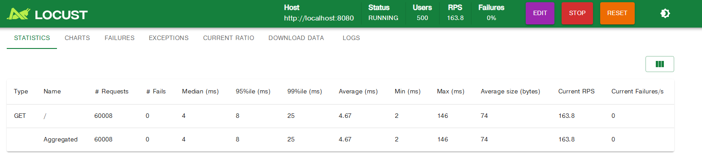
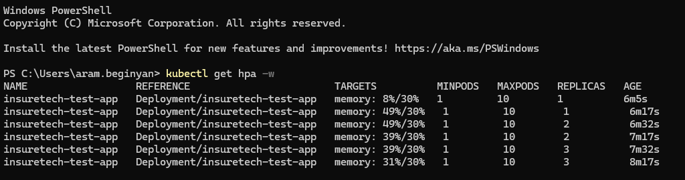
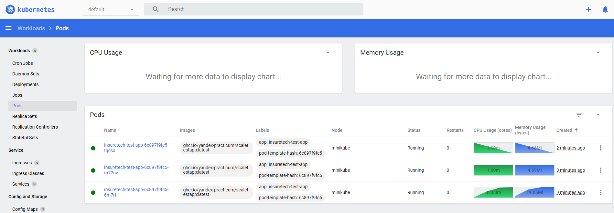

# Задание 2. Динамическое масштабирование контейнеров

Файлы:
- `deployment.yaml` — Deployment тестового приложения (1 реплика, лимит памяти 30Mi);
- `service.yaml` — Service для доступа к приложению (порт 80 -> 8080);
- `hpa.yaml` — HPA по памяти, целевая утилизация 80%, от 1 до 10 реплик;
- `locustfile.py` — сценарий нагрузки.

## Запуск

1. Поднимите кластер и включите metrics-server:

```bash
minikube start
minikube addons enable metrics-server
```

2. Примените манифесты:

```bash
kubectl apply -f deployment.yaml
kubectl apply -f service.yaml
kubectl apply -f hpa.yaml
```

3. Проверьте, что метрики поступают (через 1-2 минуты после включения metrics-server):

```bash
kubectl get pods
kubectl top pods
kubectl get hpa
```

В колонке TARGETS у HPA должно быть значение вида `NN%/80%`, а не `<unknown>/80%`.

## Нагрузочный тест

1. Пробросьте сервис на локальный порт (в отдельном терминале):

```bash
kubectl port-forward service/insuretech-test-app 8080:80
```

2. Запустите Locust в папке с `locustfile.py`:

```bash
pip install locust
locust -H http://localhost:8080
```

3. Откройте http://localhost:8089, задайте, например, 500 пользователей и скорость 20 в секунду, запустите тест.

4. Наблюдайте за ростом числа реплик:

```bash
kubectl get hpa -w
kubectl get pods -w
```

5. Откройте дашборд и сделайте скриншоты, на которых видно рост числа подов:

```bash
minikube dashboard
```

Скриншоты (или вывод `kubectl get hpa` и `kubectl get pods`) сохраните в эту же папку `Task2`.

## Замечания

- HPA считает утилизацию памяти от `requests`, поэтому в Deployment указан `requests.memory: 30Mi` (равный лимиту).
- Если нагрузки не хватает для роста памяти, увеличьте число пользователей в Locust. Память освобождается медленно, поэтому уменьшение числа реплик после теста происходит не сразу (по умолчанию окно стабилизации 5 минут).





